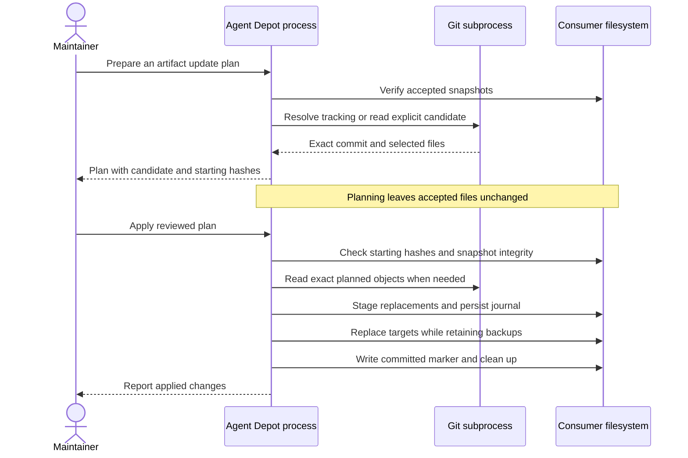

# Architecture

Agent Depot is one local Node.js CLI process, invoked by a maintainer or CI job. It uses Git subprocesses to read upstream repositories and the filesystem to maintain a consumer checkout. This describes the implemented system; there is no hosted service, registry, database or required AI runtime.

The design serves the [product acceptance criteria](product.md#observable-acceptance): keep accepted dependencies available, make upgrades reviewable and preserve local work when a change cannot complete.

## System boundary and responsibilities

The caller chooses the consumer manifest, requested operation and any candidate commit. The manifest's directory defines the consumer root. Upstreams may be remote Git repositories or explicitly declared local paths. All acquired files and declarations are untrusted input; the CLI validates them before they can become replacement targets.

The CLI runs with the caller's filesystem authority. A writer marker coordinates Agent Depot operations in that root; it is not a lock against an editor or another filesystem writer. Consumer packaging happens after acquisition and can apply its own transformations. Agent Depot does not discover agent settings, launch acquired scripts or configure remote services.

| Building block          | Responsibility and relationship                                                                                | Source                                                                        |
| ----------------------- | -------------------------------------------------------------------------------------------------------------- | ----------------------------------------------------------------------------- |
| CLI and orchestration   | Interpret the command, select artifacts and coordinate verification, plans and application                     | [CLI](../src/cli.ts), [lifecycle operations](../src/depot.ts)                 |
| Configuration           | Validate manifest, lock and plan schemas; check declarations, paths and alignment                              | [Configuration](../src/config.ts), [schemas](../schemas/manifest.schema.json) |
| Git transport           | Resolve tracking policies and read exact committed objects through bounded Git subprocesses                    | [Git acquisition](../src/git.ts)                                              |
| Snapshot and inspection | Map selected roots/resources to owned destinations; hash bytes/modes and report supported-format checks        | [Selection](../src/snapshot.ts), [inspection](../src/inspect.ts)              |
| Transactions            | Stage proposed files, journal before/after identities, replace targets with backups and reconcile interruption | [Replacement and recovery](../src/transaction.ts)                             |

These are modules inside the same process. The Git subprocess is the network boundary; it reads objects without checking out upstream worktrees or running their filters. Format inspection reads preserved content and bundled schemas, not acquired executables. The supported Agent Plugins profile is 1.0.0; unknown formats remain preservable unless strict validation is requested.

## Records, ownership and lifetime

A source describes repository identity once. Each artifact independently declares its accepted commit, selected root, destination and optional tracking policy. Sharing a repository allows reuse of the Git cache while retaining separate accepted revisions and update choices.

| Record                                        | Owner and lifetime                                                        | What it establishes                                                              |
| --------------------------------------------- | ------------------------------------------------------------------------- | -------------------------------------------------------------------------------- |
| `agent-depot.json`                            | Human-maintained and committed with the consumer                          | Repository identities, artifact pins, placement and optional consumer metadata   |
| `agent-depot.lock.json`                       | Generated and committed with snapshots                                    | Accepted declarations, file hashes/modes, aggregate digests and inspection       |
| Artifact destination directories              | Committed consumer files managed as separate, non-overlapping roots       | The accepted upstream material, directly available in a checkout                 |
| Update plan                                   | Caller-selected review file, retained until reviewed/applied or discarded | Exact proposed declarations/content identities and starting manifest/lock hashes |
| `.agent-depot/cache/`                         | Local, replaceable Git object cache                                       | Faster acquisition and offline restoration when locked objects remain cached     |
| `.agent-depot/writer.json` and `transaction/` | Local coordination and recovery state                                     | Which writer owns an operation and how interrupted replacement can be reconciled |

Paths inside a selected root remain intact under its destination. Explicit resource mappings can place external licenses or shared directories within that owned root. The [configuration reference](configuration.md#placement-and-resource-ownership) defines mappings, filtering and collisions. Required file identities are in the lock; source paths plus mappings explain where those files came from.

Each artifact owns its complete destination. Local edits and extra files cause drift, rather than becoming implicitly accepted content. Consumer-specific adaptations belong in a separate packaging step; arbitrary root `metadata` is retained without being interpreted by the acquisition engine. A missing cache does not affect verification of present snapshots, but losing both the source and cache prevents restoration of a missing snapshot.

## From accepted commit to committed snapshot

Initial acquisition follows `declaration → lock → sync → verify`. Locking reads the declared commits and records selected file identities. Sync restores missing snapshot directories at those accepted revisions, after checking existing managed directories for drift. Verification compares declarations and local files without network access or repairs.

For an established repository, declaration edits use a plan and update so the lock and files stay consistent. `lock` refuses to change the accepted lock while previously materialized snapshots exist. The [command reference](commands.md) explains each operation's write and network behavior.

## How an update reaches the commit boundary

This sequence shows an implemented CLI update in one consumer checkout. Arrows to Git may use cached objects; they do not imply a network request on every operation. The caller reviews the plan between the two invocations.

[Planning](../src/depot.ts) verifies the existing snapshot generation, reads the requested candidate and creates a proposed manifest/lock. Tracking only applies to unchanged declarations selected for discovery. Explicit declaration edits retain their specified commits, and `--to` selects one artifact's exact candidate. An unrelated upstream commit that changes none of the selected bytes/modes does not advance a tracked artifact's accepted pin.

[Application](../src/depot.ts) first checks the plan's starting manifest and lock hashes, then verifies the current snapshots. It reacquires the exact proposed content where needed and checks the proposed lock against that content and inspection. Verified unchanged snapshots can be reused without reaching their upstreams. New destinations are checked before any replacement; occupied targets and ownership overlaps fail.

The [transaction layer](../src/transaction.ts) stages the changed roots and control files, records their before/after identities, and persists the journal before replacing a target. It then moves old targets into backups and installs replacements. Only after all replacements succeed does it write a committed marker. It moves the completed transaction out of the recovery path before deleting backups, so interrupted cleanup cannot look like an uncommitted partial generation.

This is recoverable multi-target replacement, not a filesystem-wide atomic commit. Another process could observe intermediate replacements. Readers should not consume the checkout concurrently with an update; review a completed generation or a separate checkout instead.

## Failure, retry and recovery

| Failure boundary                                    | Accepted/recovery state                                                 | Next operation                                                                             |
| --------------------------------------------------- | ----------------------------------------------------------------------- | ------------------------------------------------------------------------------------------ |
| Candidate lookup, selection or inspection fails     | No accepted replacement has started                                     | Correct access/declaration issues and prepare a new plan                                   |
| Plan base or current snapshot no longer matches     | Application refuses the candidate                                       | Preserve local work; reconcile the baseline and replan                                     |
| Replacement fails before the committed marker       | The CLI attempts rollback; an incomplete rollback leaves recovery state | Stop the earlier writer and run `recover`                                                  |
| All replacements finish, but cleanup is interrupted | The committed marker identifies the completed generation                | `recover` verifies and retains the new generation, then finishes cleanup                   |
| Files or backups change after interruption          | Recorded identities cannot safely determine what to restore             | `RECOVERY_CONFLICT`; preserve current files, backups and journal for manual reconciliation |

Recovery validates every journal target before modifying any target. For an uncommitted replacement, recovery restores previous targets from available backups in reverse order; a committed generation is retained only if it still matches its recorded state. The writer marker can be reclaimed automatically only for a demonstrably dead process on the same host.

A lost success response does not prove the old generation is still present: replacement may already have committed. Verify and inspect the resulting manifest/lock before retrying. Reapplying a plan after it changed those base records fails as stale. These mechanics are exercised with disposable Git repositories and simulated interrupted journals; they do not establish power-loss durability or protection against malicious edits to the control records. See the [recovery procedure](delivery.md#recover-an-interrupted-operation) for operator steps.

## Accepted decisions

| Decision                                                                                                               | Status   | Consequence                                                                                                 |
| ---------------------------------------------------------------------------------------------------------------------- | -------- | ----------------------------------------------------------------------------------------------------------- |
| [Commit acquired snapshots in the consumer repository](decisions/0001-committed-snapshots.md)                          | Accepted | Checkouts retain content at the cost of repository size and reviewed update diffs                           |
| [Separate repository identity, artifact pins and consumer policy](decisions/0002-artifact-pins-and-consumer-policy.md) | Accepted | Independent artifact revisions and placement without coding-agent installation or embedded adaptation rules |

These records explain consequential choices and alternatives. Schemas remain the authoritative field contracts; operational procedures remain in [delivery](delivery.md).
